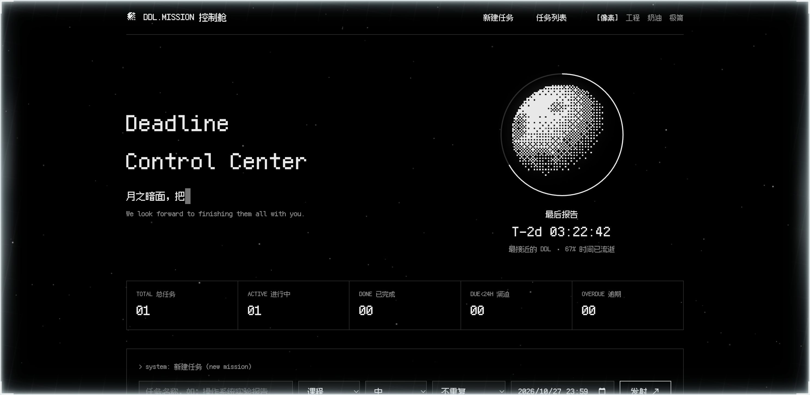

# DDL.MISSION 控制舱

像素太空风的 DDL（截止日期）管理器 —— 单文件网页应用 + 本地同步服务器 + macOS 桌面小组件 + GitHub Pages 在线版。
默认皮肤致敬 [careers.kimi.com](https://careers.kimi.com)，另内置 **工程（Linear）/ 奶油（Anthropic）/ 极简（Vercel）** 三套一键切换主题。



## 功能

- **秒级实时倒计时**：`T-2d 03:22:42` 每个任务独立跳动；<24h 反色、逾期反色闪烁
- **日食倒计时环**：绕月球的光环 = 最紧急任务的时间流逝比（Canvas + Bayer 有序抖动渲染的像素月球，缓慢自转）
- **自然语言输入**：`明天23:59 交报告` / `每周五 18:00 实习周报` / `3天后 还书` / `12月31日 跨年`，自动识别时间、循环周期、分类（课程/工作）、优先级（紧急→高）
- **循环任务**：每天 / 每周 / 每月，勾选自动续期到下一周期
- **macOS 原生通知**：T-24h / T-1h / 已逾期三档提醒，由常驻服务器发出，**浏览器关了也能收到**
- **四套主题一键切换**：像素 / 工程 / 奶油 / 极简，经服务器全端同步
- **多端实时同步**：桌面小组件、浏览器、局域网设备，同一份数据 5 秒互通
- **桌面小组件**：300px 精简倒计时视图，可拖动（位置记忆），点任务行直接跳转网页版

## 快速开始

```bash
git clone https://github.com/Zc-RUC/ddl-mission.git
cd ddl-mission
python3 server.py            # 启动本地服务器（同步 + 通知），监听 0.0.0.0:8791
open http://127.0.0.1:8791   # 打开网页版
```

不想起服务器也行：**双击 `index.html`** 即可使用（像素字体已内嵌，离线可用；数据降级为浏览器 localStorage，服务器在线时自动回迁同步）。

## 桌面小组件（macOS，可选）

1. 安装 [Übersicht](https://tracesof.net/uebersicht/)（免费开源）
2. 把 `ubersicht/ddl-mission.widget` 整个文件夹复制到
   `~/Library/Application Support/Übersicht/widgets/`
3. Übersicht 菜单栏图标 → Refresh All Widgets

小组件说明：顶部 `···` 条拖动换位；底栏「皮肤」循环换肤；点任务行跳转网页版（经由 Übersicht 内置 `/run/` 端点拉起系统默认浏览器）。

## 局域网多设备

服务器默认监听 `0.0.0.0:8791`。同一 Wi-Fi 下的手机 / iPad / 其他电脑直接打开
`http://<你的Mac名>.local:8791`（或 `http://<Mac的IP>:8791`），与 Mac 上的小组件、网页版实时同步。

## GitHub Pages

仓库开启 Pages（Settings → Pages → Deploy from a branch → main）即可获得在线版地址
`https://<用户名>.github.io/ddl-mission/`。在线版数据存浏览器本地；在运行服务器的同一台 Mac 上访问时，允许 Chrome 的「本地网络」权限后也能与服务器同步。

## 数据与隐私

- 数据存本机 `tasks.json` / `settings.json`（已在 .gitignore 排除），无任何云端上传
- 服务器带 CORS 白名单（仅 file://、127.0.0.1/localhost、本仓库 Pages 域）与 PNA 响应头
- 注意：服务器监听全网卡，在不可信网络（咖啡厅等）同网段他人可访问你的任务列表，介意可自行加一层口令校验

## 换肤 / 二次开发

加一套主题 = 两步：

1. `index.html` 里仿照现有块，追加一个 `body[data-theme="xxx"] { --bg: ...; --fg: ...; --accent: ...; --font: ...; }` 变量组（`widget.html` 同样补一块）
2. 导航 `#themes` 和小组件的 `THEME_ORDER` 里登记新主题名

任务与主题分别经 `GET/PUT /api/tasks`、`GET/PUT /api/settings` 同步，轮询 5 秒。

## 技术栈

- 纯原生 HTML/CSS/JS，零依赖零构建，单文件 `index.html`（像素字体 Fusion Pixel 12px Mono，SIL OFL 协议，已内嵌）
- `server.py`：仅标准库（http.server），静态托管 + JSON 存储 + 通知值守
- `widget.html`：小组件精简视图；`ubersicht/`：Übersicht widget 外壳（拖动、自适应高度、跳转）

## License

MIT（字体文件 fusion-pixel.otf 遵循其自身的 SIL Open Font License）
